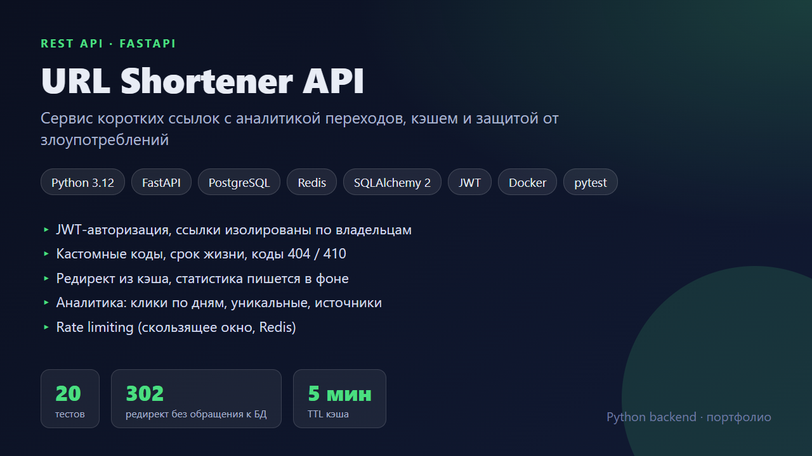
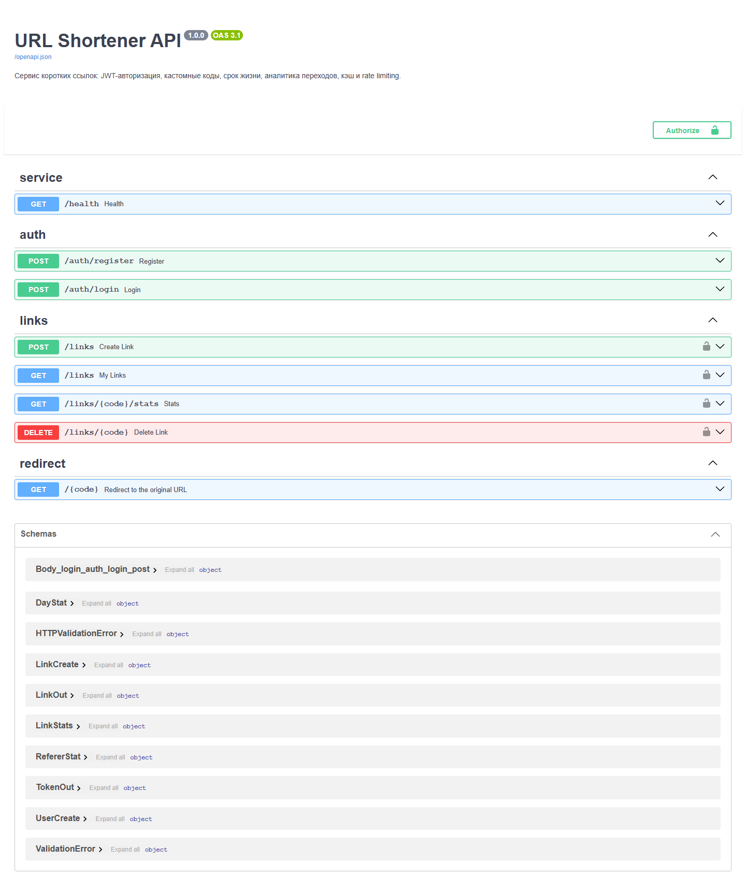
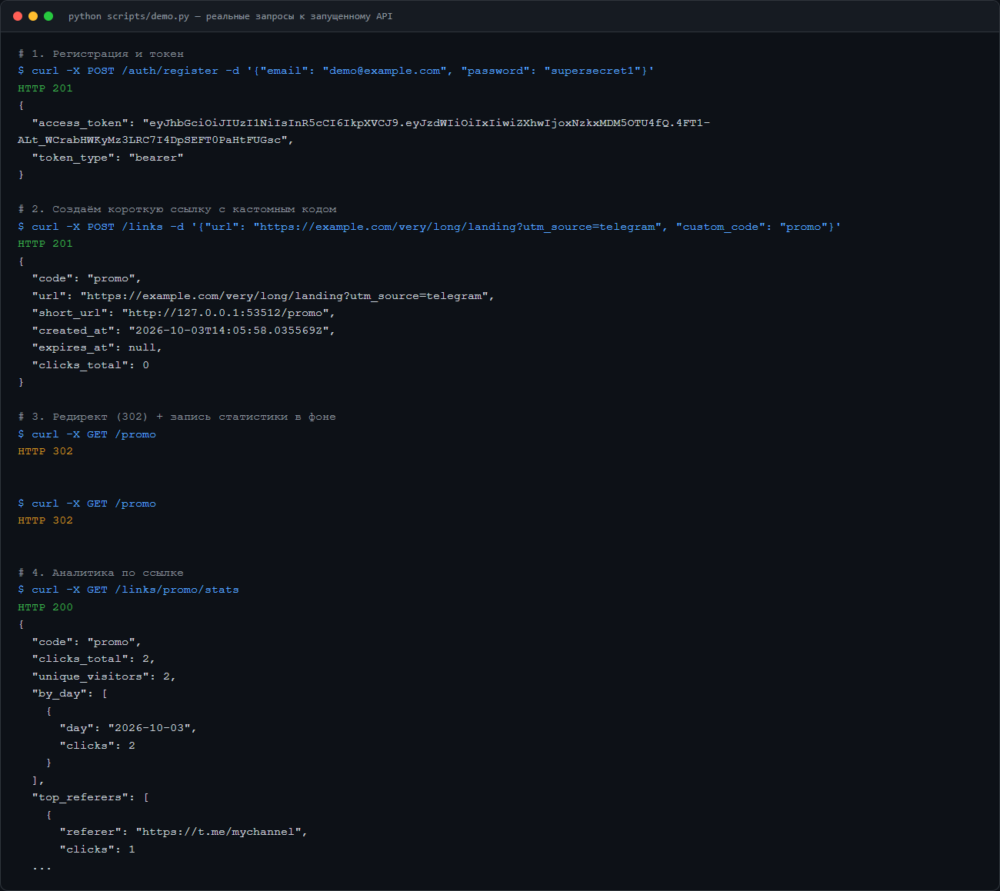
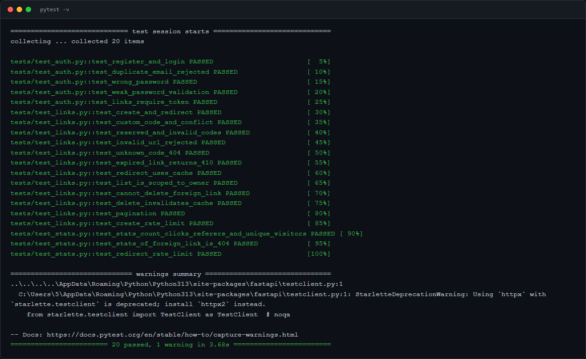

# URL Shortener API

  

Сервис коротких ссылок: регистрация, создание ссылок (в том числе со своим кодом и сроком жизни), быстрый редирект и аналитика переходов.



## Что внутри

| Возможность | Реализация |
|---|---|
| Авторизация | JWT (PyJWT), пароли — bcrypt |
| Короткие коды | `secrets`, base62, повтор при коллизии, кастомные коды с валидацией и зарезервированными словами |
| Быстрый редирект | кэш (Redis, либо in-memory), TTL не дольше срока жизни ссылки |
| Статистика | запись клика через `BackgroundTasks` — редирект не ждёт БД; IP не хранится, только хэш |
| Аналитика | клики по дням, уникальные посетители, топ источников |
| Защита | rate limit (скользящее окно, Redis `INCR`/in-memory), `429` + `Retry-After` |
| Коды ответов | `302` / `404` / `410` (истекла) / `409` (код занят) / `422` / `429` |

## Запуск

```bash
docker compose up --build        # API + PostgreSQL + Redis
# http://localhost:8000/docs
```

Без Docker (SQLite, кэш в памяти):

```bash
pip install -r requirements.txt
uvicorn app.main:app --reload
python scripts/demo.py           # прогон сценария из скриншота ниже
pytest                           # 20 тестов
```

Переменные окружения: `DATABASE_URL`, `REDIS_URL`, `SECRET_KEY`, `RATE_LIMIT_CREATE`, `RATE_LIMIT_REDIRECT`.

## Скриншоты

| Swagger | Демо-сценарий | Тесты |
|---|---|---|
|  |  |  |

## Структура

```
app/
  main.py          # приложение, lifespan
  models.py        # User, Link, Click
  schemas.py       # pydantic-схемы и валидация
  infra.py         # Cache и RateLimiter (Redis / in-memory)
  deps.py          # текущий пользователь из JWT
  routers/         # auth, links, redirect
tests/             # pytest, in-memory SQLite
```

## Что можно улучшить дальше
Миграции Alembic вместо `create_all`, партиционирование таблицы кликов, агрегаты по дням в Redis.
